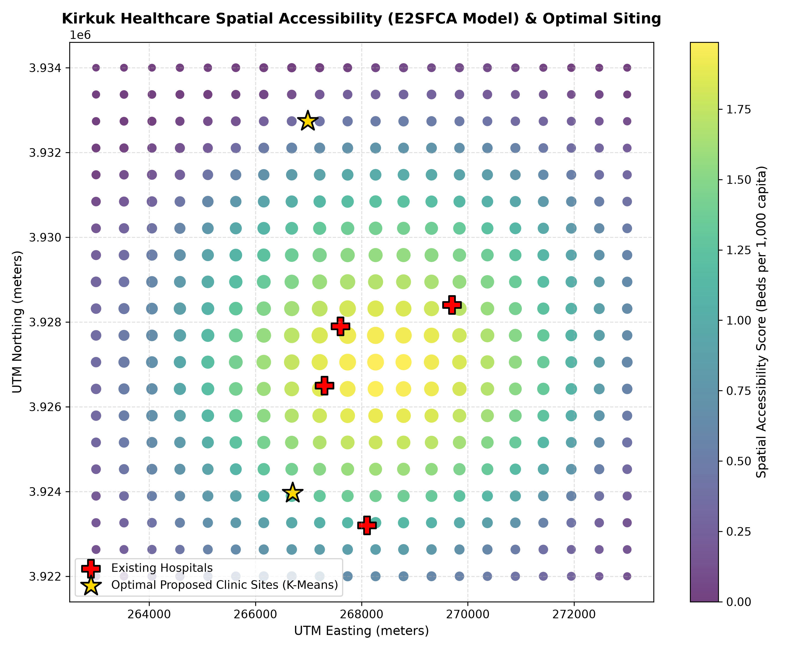

# Mapping Healthcare Access & Desert Corridors in Kirkuk

A spatial epidemiology study and interactive dashboard looking at acute care distribution across Kirkuk, Iraq. 
## [Live Link](https://kirkuk-healthcare-access-ikqq87vwup9smdaquksdyw.streamlit.app)


Instead of drawing basic radius circles around hospitals, this project uses the Enhanced Two-Step Floating Catchment Area (E2SFCA) method to account for provider capacity, travel friction, and cross-neighborhood demand.

---

## Why This Matters

Kirkuk's major acute care facilities (Azadi Teaching, Kirkuk General, Pediatric, and Al-Nasr) are historically concentrated along the central city spine. Rapid residential expansion over the past decade has pushed large population pockets to the outer perimeters, creating informal "healthcare deserts."

This project pairs real demographic satellite data with spatial accessibility modeling to:
1. Identify which residential districts fall below the minimum threshold for acute bed access.
2. Run facility siting optimization to find where new primary clinics would relieve the most pressure on the healthcare system.

---

## How It Works

* **E2SFCA with Continuous Gaussian Decay:** Unlike standard 2SFCA models that drop off abruptly at a hard boundary, this applies a continuous Gaussian decay function. Access scores degrade realistically as travel distance increases up to a default 6 km threshold.
* **Metric Accuracy:** All coordinates are projected into **UTM Zone 38N (EPSG:32638)** so distance calculations reflect ground meters rather than distorted degree approximations.
* **Weighted Siting Optimization:** Uses weighted $k$-means clustering on underserved population points ($< 1.0$ bed per 1,000 residents) to calculate the mathematical centers of gravity for proposed new clinic sites.

---

## Data & Limitations

* **Population:** Extracted from the UN OCHA / WorldPop 2020 building-constrained 100m raster (`irq_ppp_2020_UNadj.tif`). This reflects residential night-time density rather than daytime commercial foot traffic.
* **Facility Capacity:** Based on operational bed capacities from Ministry of Health specifications (Kirkuk General: 400, Azadi: 400, Pediatric: 120, Al-Nasr: 180).
* **Distance Metric:** Pairwise distance is currently measured using Euclidean distance. While effective for macro-level regional disparities, it does not factor in real-time road congestion or bridge bottlenecks across the Khasa riverbed.

---

## Repository Layout

* `app.py`: Streamlit dashboard with sensitivity sliders and interactive map layers.
* `spatial_analysis.py`: Standalone Python script running the mathematical matrix operations and generating analytical plots.
* `process_raster.py`: Raster clipping script used to extract the Kirkuk metropolitan window from the national GeoTIFF.
* `kirkuk_real_population.csv`: Processed demographic coordinate nodes used by the application.

---

## Running Locally
```bash
git clone [https://github.com/yunu5/kirkuk-healthcare-access.git](https://github.com/yunu5/kirkuk-healthcare-access.git)
cd kirkuk-healthcare-access

# Create virtual environment
python -m venv .venv
source .venv/bin/activate  # On Windows: .venv\Scripts\activate

# Install dependencies and launch
pip install -r requirements.txt
streamlit run app.py
